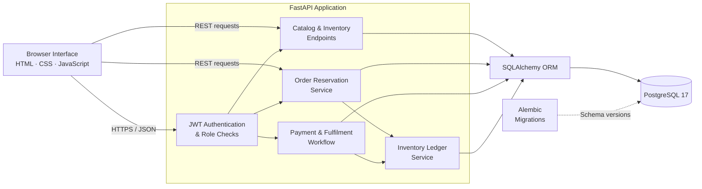
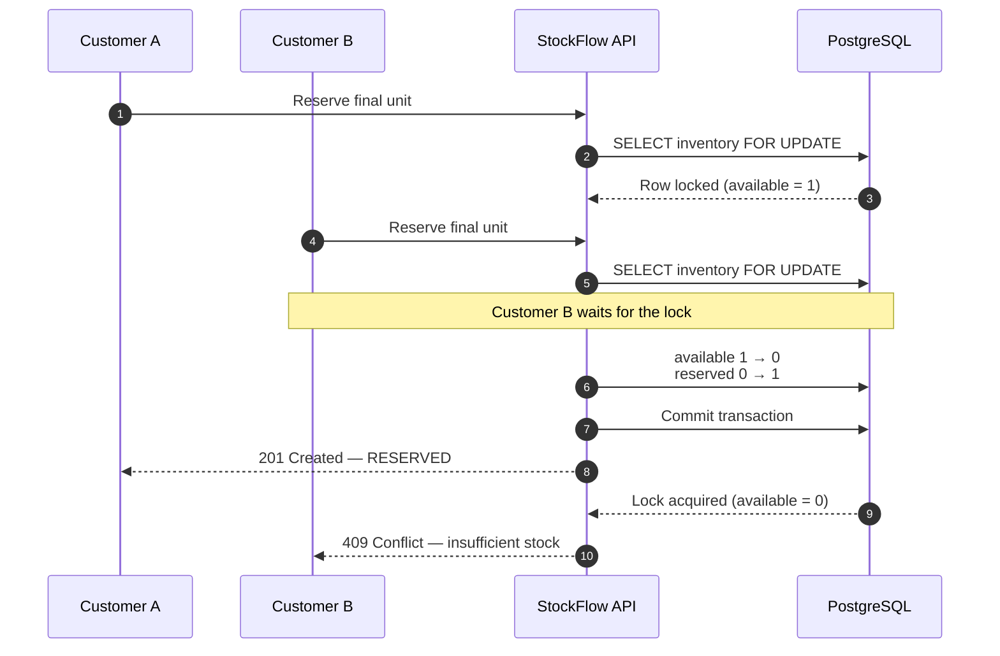
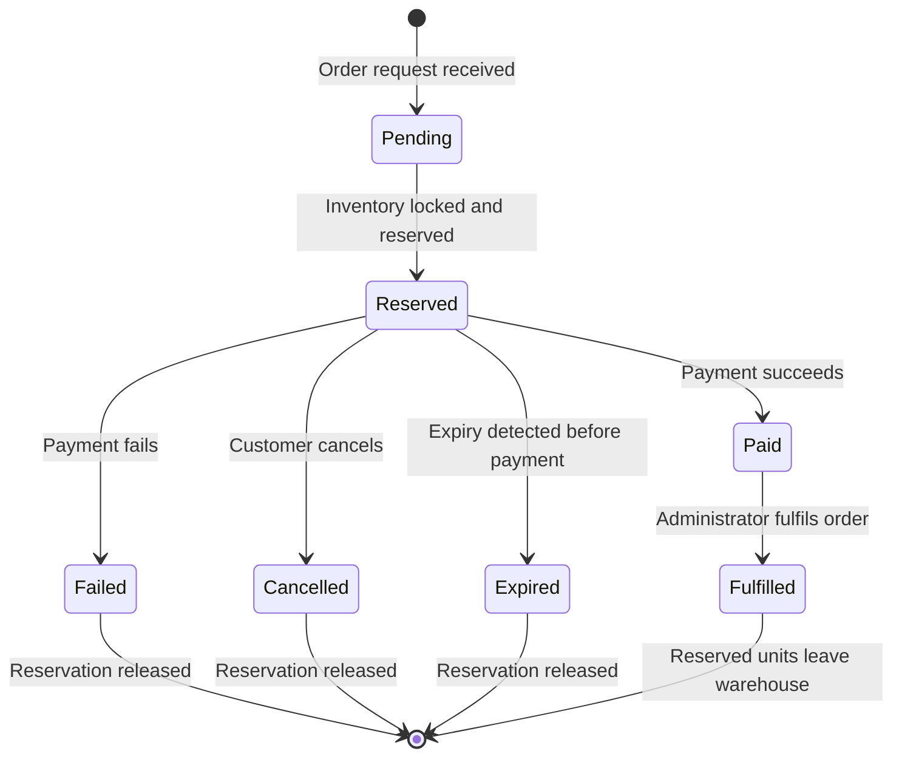
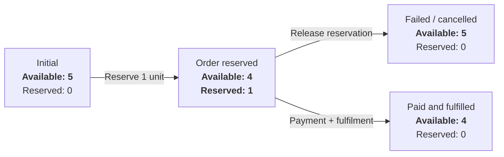

# StockFlow

**A transactional inventory and order-fulfilment platform that prevents overselling,
manages temporary stock reservations, and records every inventory change in an auditable
ledger.**

Built with FastAPI, PostgreSQL, SQLAlchemy, JWT authentication, and Docker.

[](https://github.com/Sashwath-sash/stockflow/actions/workflows/ci.yml)
[](https://www.python.org/)
[](https://fastapi.tiangolo.com/)
[](https://www.postgresql.org/)

## Overview

StockFlow models the backend workflow used by inventory-based commerce systems.
Customers can reserve available products and complete or cancel orders. Administrators
manage products, warehouses, stock, and fulfilment. Inventory updates run inside database
transactions so two customers cannot reserve the same final unit.

## Core Features

- Customer registration and JWT-based authentication
- Role-based customer and administrator access
- Product and multi-warehouse inventory management
- Transactional 15-minute stock reservations
- Simulated payment success and failure flows
- Order cancellation and reservation release
- Administrator-controlled fulfilment
- Immutable inventory movement ledger
- Idempotent order creation
- Admin order filtering and pagination
- Liveness and database-readiness endpoints
- Interactive Swagger API documentation
- Automated tests and GitHub Actions CI

## System Architecture



## Why StockFlow Is More Than CRUD

### Transactional reservations

Order creation locks the relevant PostgreSQL inventory rows before checking and changing
their quantities. When two customers request the final unit, one transaction completes
first and the second sees that no stock remains.



### Idempotent order creation

Each order request carries an `Idempotency-Key`. StockFlow stores the key with a hash of
the request. Retrying the same request returns the existing order; reusing the key for
different order data returns a conflict.

### Auditable inventory ledger

Every stock operation creates a movement record containing the movement type, available
and reserved deltas, resulting quantities, related order, reason, and timestamp. Inventory
history is therefore traceable instead of being silently overwritten.

## Order Lifecycle



### Inventory state transitions



## Technology Stack

| Area | Technologies |
| --- | --- |
| Backend | Python 3.12, FastAPI, Pydantic |
| Database | PostgreSQL 17 |
| ORM and migrations | SQLAlchemy 2, Alembic |
| Authentication | JWT, Argon2 password hashing |
| Frontend | HTML, CSS, vanilla JavaScript |
| Infrastructure | Docker, Docker Compose |
| Testing and quality | Pytest, Ruff, GitHub Actions |

## Run Locally

### Requirements

- Docker Desktop with the Linux engine running
- Git

### Setup

```powershell
git clone https://github.com/Sashwath-sash/stockflow.git
cd stockflow
Copy-Item .env.example .env
docker compose up --build
```

Open:

| Resource | URL |
| --- | --- |
| Storefront and dashboard | <http://localhost:8000> |
| Swagger API documentation | <http://localhost:8000/docs> |
| API liveness | <http://localhost:8000/health> |
| Database readiness | <http://localhost:8000/health/ready> |

The development administrator is configured through `.env`. Never commit `.env` or
reuse its credentials in a deployed environment.

Stop the application:

```powershell
docker compose down
```

> `docker compose down -v` also deletes the PostgreSQL volume and all local StockFlow
> data. Use it only when a complete reset is intended.

## Demonstration Flow

1. Sign in using the administrator configured in `.env`.
2. Create a product and warehouse, then add inventory.
3. Register or sign in as a customer.
4. Add the product to the cart and reserve the order.
5. Simulate a successful payment.
6. Sign back in as administrator and fulfil the paid order.
7. Inspect inventory and the movement ledger.
8. Repeat with a failed payment to verify that reserved stock is released.

## Main API Endpoints

| Method | Endpoint | Access | Purpose |
| --- | --- | --- | --- |
| `POST` | `/api/v1/auth/register` | Public | Register a customer |
| `POST` | `/api/v1/auth/login` | Public | Authenticate and receive a JWT |
| `GET` | `/api/v1/auth/me` | Authenticated | Read the current user |
| `GET` | `/api/v1/catalog/products` | Public | List active products |
| `GET` | `/api/v1/catalog/availability` | Public | View warehouse availability |
| `POST` | `/api/v1/orders` | Customer | Reserve inventory and create an order |
| `POST` | `/api/v1/orders/{id}/payment` | Customer | Simulate a payment result |
| `POST` | `/api/v1/orders/{id}/cancel` | Customer | Cancel an active reservation |
| `POST` | `/api/v1/admin/inventory/adjust` | Admin | Adjust available inventory |
| `GET` | `/api/v1/admin/orders` | Admin | Filter and paginate orders |
| `POST` | `/api/v1/admin/orders/{id}/fulfil` | Admin | Fulfil a paid order |
| `GET` | `/api/v1/admin/inventory/movements` | Admin | View the inventory ledger |

The complete request and response schemas are available in Swagger at `/docs`.

### Admin order filtering

Administrators can retrieve a specific page of orders and optionally filter by state:

```http
GET /api/v1/admin/orders?status=paid&limit=20&offset=0
```

| Parameter | Meaning |
| --- | --- |
| `status` | Optional order-state filter |
| `limit` | Records to return, from 1 to 100 |
| `offset` | Records to skip before returning results |

## Data Invariants

Every inventory record maintains:

```text
available_quantity >= 0
reserved_quantity >= 0
```

Reservation and release operations use database transactions and row locks. Multi-line
orders acquire inventory locks in deterministic order to reduce deadlock risk.

## Testing

Install the development dependencies:

```powershell
pip install -e ".[dev]"
```

Run the automated tests and code-quality checks:

```powershell
pytest
ruff check .
```

The current automated tests cover:

- Password hashing and verification
- JWT creation, decoding, and invalid-token rejection
- Stable idempotency request hashing
- Detection of changed order content
- Successful database-readiness checks
- `503 Service Unavailable` when the database cannot be reached

GitHub Actions runs the test suite and Ruff checks after every push and pull request.

## Future Improvements

- Background worker for proactively expiring reservations
- Real payment-provider integration with signed webhooks
- Redis-backed rate limiting and caching
- Cursor-based pagination for large datasets
- Structured logging, metrics, and distributed tracing
- Production deployment with managed PostgreSQL and secret management
